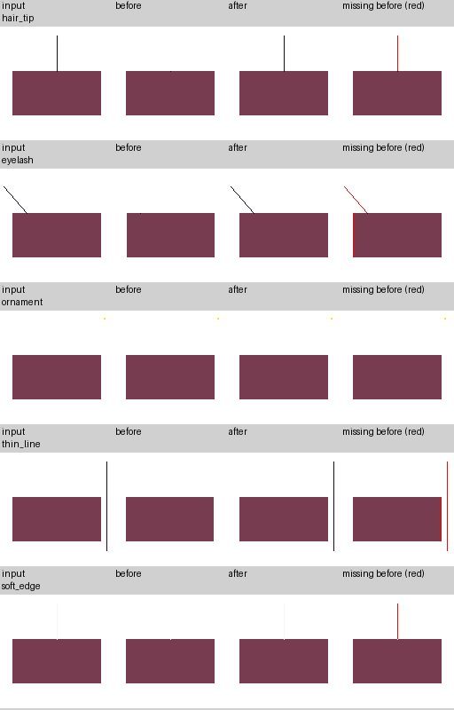
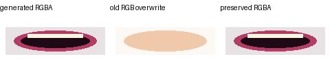

# SD 캐릭터 품질 진단과 최소 수정 (PR #7)

기준: `main e36ce4b`. 실제 사용자 캐릭터의 원본/PSD/모델은 이번 검증에 제공되지 않았다.
따라서 아래의 **재현된 코드 결함**과 **실제 캐릭터에서 확인할 가설**을 구분한다.
RTX 4060, CUDA 추론, Cubism Core, VTube Studio의 실행·품질은 미검증이다.

## 진단 결과와 수정 범위

| 단계 | 확인된 동작 / 재현 결과 | 이번 조치 |
|---|---|---|
| LayerDiff | 생성 RGB/alpha 자체가 원본과 달라질 수 있음. 실제 캐릭터의 손실 발생 여부는 미확인 | 입력 PNG별 RGB/alpha/합성 이미지 저장. 추론 설정 변경 없음 |
| PSD 후처리 | 고정 upstream `further_extr`가 입 alpha를 유지하고 RGB 전체를 원본 crop으로 덮어씀. 넓은 alpha에 원본 피부색이 들어오는 것을 재현 | 입 덮어쓰기만 제거. 생성된 입 RGBA 유지. 코 처리는 그대로 |
| PSD → 파츠 | alpha 정리, 작은 성분 제거, 좌우 분리 과정이 있음. 실제 외곽선 손실 기여는 미확인 | 원시 PSD와 현재 importer로 재구성한 정규화 파츠를 따로 기록. 정리/분리 규칙 변경 없음 |
| 메시 | bbox의 2% 질량 문턱이 연결된 1px 끝을 자름. 셀의 3×3 샘플은 가는 선을 놓침 | PNG에서 alpha ≥ 8인 픽셀의 실제 bbox 및 셀 전체 픽셀 포함 검사 |
| 아틀라스 | crop, 공간 부족 시 축소, 보간이 존재. 실제 사용자 결과의 영향 미확인 | 원래 파츠와 atlas crop 복원 비교, source/packed 크기 및 중립 합성 저장. packer 변경 없음 |
| 눈/얼굴 | 얼굴 베이스에 남은 특징과 별도 눈·입의 중복 가능. 중간 눈 감김에서 양쪽 레이어가 보일 수 있음 | 어두운 색상 일치 후보 표시, 0/0.25/0.5/0.75/1 눈 감김 참고 이미지. 자동 지우기/인페인팅/리깅 변경 없음 |

메시의 14×14 격자 및 최대 **392개 삼각형**은 유지한다. 셀 검사에는 Pillow의 C 구현을 사용하고,
추가 integral-image 버퍼 없이 작은 crop을 검사한다. 합성/피벗 계산에서 사용하는 기존
`alpha_bbox` 함수는 유지하고, 실제 PNG 메시 생성만 픽셀 bbox를 사용한다.
이미 정리된 파츠를 기준으로 보존하므로 **이전 PSD 정리 단계에서 사라진 픽셀은 복원하지 않는다**.
직접 제공한 PNG에 멀리 떨어진 잡음이 남아 있으면 메시 bbox도 넓어진다. 정확한 알파 보존의
트레이드오프이며 실제 캐릭터의 변형 피벗/격자 분포는 검토해야 한다.

## 오프라인 진단 사용법

필요 패키지: `pip install -e '.[app]'`. GPU나 모델 가중치가 필요하지 않다.
진단 디렉터리는 **새 경로**여야 한다. 기존 보고서와 섞이지 않도록 기존 경로는 거부한다.
진단 이미지에는 원본 캐릭터가 포함되므로 공유 범위를 직접 정한다.

Python API의 `ConversionResult.rig`를 IRR JSON으로 저장할 수 있다. 웹 `/rig` JSON과는 다른 형식이다.
기존 PSD에서 새로운 작업 디렉터리로 모델을 생성하며 입력 PSD를 변경하지 않는 예:

```python
from pathlib import Path
from image2live2d import convert_psd

result = convert_psd("hero.psd", "quality_run/model", work_dir="quality_run/layers", live2d=True)
Path("quality_run/rig.json").write_text(result.rig.model_dump_json(indent=2), encoding="utf-8")
```

```bash
python -m image2live2d.core.qa.visual \
  --rig quality_run/rig.json --assets quality_run/layers \
  --original aligned_src_img.png \
  --layerdiff saved_layerdiff_png_directory \
  --psd hero.psd --output quality_run/diagnostics
```

`--original`, `--layerdiff`, `--psd`는 선택 사항이다. 누락 단계는 보고서에 missing으로 기록된다.
`--original`은 모델과 **동일한 캔버스/정렬**이어야 한다. See-through의 square padding/resize를
거친 `src_img.png`를 우선 사용한다. 크기가 다르면 임의 확대하지 않고 unaligned로 표시한다.
같은 크기라도 정렬이 다를 수 있으므로 pixel difference만으로 결함이라고 판정하지 않는다.

LayerDiff PNG는 backend 작업의 저장 디렉터리에서 가져온다. PR #6의
`checkpoints/manifest.json`에 기록된 완료 결과를 확인하고 그 안의 실제 태그 PNG 디렉터리를
지정한다. 원본 체크포인트를 수정하지 말고 필요하면 복사본을 사용한다.
PSD와 LayerDiff는 **같은 실행/설정/입력**의 결과여야 한다.

기존 모델의 정확한 atlas를 비교하려면 그 모델에 대응하는 UV remap도 필요하다:

```bash
python -m image2live2d.core.qa.visual \
  --rig quality_run/rig.json --assets quality_run/layers \
  --atlas captured/atlas/rgba.png --uv-remap captured/atlas/uv_remap.json \
  --output quality_run/existing_atlas_diagnostics
```

atlas와 remap을 제공하지 않으면 현재 production packer로 **재생성**하고 보고서에 명시한다.
실제 export 시점의 atlas/remap을 잡으려면 다음 opt-in API를 사용한다:

```python
from image2live2d.backends.live2d.emitter import Live2DEmitter
Live2DEmitter(asset_root="quality_run/layers").build(
    result.rig, "quality_run/captured_model", diagnostics_dir="captured")
```

기본 실행에서는 진단을 하지 않으며 모델 파일 형식/ZIP 내용도 바뀌지 않는다.
진단은 CPU 및 디스크를 사용하므로 일반 추론 제한 시간 안에 자동으로 실행하지 않는다.

## 보고서 읽는 순서

1. `report.md` / `report.json`: 단계 가용성, 파츠 이름, missing pixel 수, 최초 관찰 변화,
   비교 수치, 후보 영역. `rig.json`은 비교한 기존 메시를 보존한다.
2. `layerdiff/`: PNG별 RGBA, 숨겨진 RGB까지 포함한 RGB, alpha, 흰색/검정 배경 합성.
   순서 없는 PNG를 임의로 neutral이라고 부르지 않는다. PSD 태그명과 크기가 정확히 일치할 때만
   PSD 순서의 합성도 만들고, 일부 태그만 일치하면 `complete: false`로 기록한다.
3. `psd/`: offset을 적용한 raw leaf 레이어, importer 순서의 합성.
   PSD group effects/mask의 공식 Photoshop 합성을 검증하는 도구는 아니다.
4. `normalized/`, `normalized_assets/`: 현재 PSD importer로 재구성한 정리/분리 결과(합성 파츠 추가 전).
   `psd_to_normalized`는 이 단계의 변화를, `normalized_to_neutral`은 이후 변화 전체를 보여준다.
5. `parts/`: 전달한 rig의 실제 텍스처. `missing_alpha.png`에서 **빨강**은 UV 삼각형 밖의
   alpha ≥ 8 픽셀이다. 픽셀 중심의 barycentric 판정으로 측정하며 경계를 팽창하지 않는다.
6. `neutral/`, `original_to_neutral/`: 기본 parameter 값의 CPU 참고 렌더와 원본 차이.
   alpha와 premultiplied RGB 차이를 비교해 투명 픽셀의 숨겨진 RGB를 결함으로 오인하지 않는다.
7. `atlas/`, `atlas_parts/`, `atlas_neutral/`: 실제/재생성 atlas와 원래 파츠 크기로 복원한 비교.
   축소된 crop은 nearest로 복원해 손실을 드러낸다. `packed_size`를 확인한다.
8. `duplicate_*.png`의 **자홍색**과 `blink/`: 얼굴 베이스/별도 특징의 유사한 어두운 픽셀,
   중간 눈 감김 이미지. 화풍, 그림자, 정상 겹침에도 후보가 생긴다. 후보만으로 삭제하지 않는다.

`first_observed_change`는 입력이 제공된 비교들 중 처음 변화가 보인 구간이며, **결함의 확정 위치가
아니다**. PSD 정리, 생성 파츠, 정상 가림에도 차이가 생긴다. 메시 UV alpha 손실은 별도의 확정
수치로 보고한다. 부족한 중간 단계 때문에 최초 원인을 판정할 수 없으면 `earliest_defect`는
미확정으로 남긴다. 자동 의미 분할이나 가려진 얼굴 복원은 구현하지 않는다.

참고 렌더러는 기본값/눈 감김의 per-vertex offset과 opacity를 적용하고 같은 파츠의 삼각형 경계를
중복 합성하지 않는다. nearest texel sampling을 사용하며 Cubism warp, physics, GPU filtering,
클리핑을 그대로 재현하지 않는다. 실제 VTube Studio 눈 감김 확인을 대체하지 않는다.

## upstream 입 수정 적용

대상 upstream: `shitagaki-lab/see-through`의
`58a1cb11d13f85acec9bbddb8cd4b6487843d4cf`,
`common/utils/inference_utils.py::further_extr`의 입 RGB 대입 블록 하나.

저장소 내부 패처: `service/seethrough/patches/preserve_mouth_rgb.py`.
정확한 텍스트 anchor를 검사하고 AST 파싱 후 저장하며 반복 적용은 no-op이다.
anchor가 바뀌면 exit 3으로 실패한다. Dockerfile은 build 중 이를 적용하고 실패 시 build를 중단한다.
VM `startup.sh`도 적용하며 기존 부트 정책대로 실패 시 경고한다. 패치 다운로드 URL은 새 패처가
존재하는 `NabomE2/image2live2d`로 정정했다. 브랜치 시험 시 `patch-ref`를 설정한다.

수동 설치 환경에서는 서비스 재시작 전에 실행:

```bash
python service/seethrough/patches/preserve_mouth_rgb.py \
  /path/to/see-through/common/utils/inference_utils.py
```

기존 PSD의 RGB는 소급해서 바뀌지 않는다. 새 패치로 PSD를 다시 생성해야 한다.
체크포인트의 코드 해시가 바뀌므로 기존 완료 결과의 재사용이 거부될 수 있다. 이는 PR #6의
캐시 검증 동작이며 해시를 조작해서 이전 PSD를 재사용하면 안 된다.

이 수정은 **원본 RGB로부터 새로 유입되는 오염만 방지**한다. 생성된 입 자체에 피부색이나 넓은
alpha가 이미 있다면 남는다. 색상 문턱으로 피부색을 지우지 않으므로 입술/치아/구강 내부의
정상 색상과 alpha를 보존한다. 대신 생성된 입 색이 원본보다 부정확한 경우 원본 RGB 덮어쓰기의
이점이 사라질 수 있다. 실제 캐릭터 비교 후 필요하면 별도 유효영역 추정 기능을 검토한다.

## 검증과 후속 우선순위

합성 회귀 비교(실제 캐릭터/GPU 결과 아님):



| 사례 | 수정 전 누락 픽셀 | 수정 후 | 삼각형 전 → 후 |
|---|---:|---:|---:|
| 1px 머리카락 끝 | 40 | 0 | 392 → 236 |
| 대각선 속눈썹 | 80 | 0 | 364 → 252 |
| 작은 장식 | 0 | 0 | 226 → 226 |
| 1px 선 | 151 | 0 | 364 → 236 |
| alpha=8 가는 경계 | 40 | 0 | 392 → 236 |



수치는 `quality/synthetic-results.json`. 작은 장식은 원래 통과하던 사례도 유지되는지 검사했다.
1024px 합성 PNG의 로컬 CPU 측정 5회 중앙값은 기존 약 0.106초, 수정 후 약 0.015초였다.
기존 비교는 메모리에 열린 이미지, 수정 후는 PNG 로딩까지 포함한다. 단일 환경 참고치이며
LayerDiff 추론 속도나 RTX 4060 성능 개선 수치가 아니다.

재현 테스트:

```bash
SEE_THROUGH_TEST_SOURCE=/path/to/pinned/see-through \
  python -m pytest -q tests/test_visual_quality.py tests/test_mesh.py
```

- **우선 1:** 사용자 캐릭터의 동일 실행 LayerDiff/PSD/rig/atlas 진단 수집. 메시 커버리지 및
  원본-중립/중간 눈 감김을 VTube Studio와 대조한다.
- **우선 2:** 생성된 입 자체에 문제가 남으면 alpha와 유효 입 영역의 분리 방안을 비교한다.
  피부색 제거는 입술/치아 소실 위험이 있어 현재 도입하지 않았다.
- **우선 3:** 얼굴 베이스의 눈·입 잔상이 실제 확인되면 해당 영역만 복원하는 opt-in 방법을
  설계한다. 자동 인페인팅은 표정/화풍 변경 위험이 크다.
- **우선 4:** atlas 축소 또는 정규화 speck 제거가 최초 손실 단계로 확인될 때만 각각 개선한다.
  atlas edge extrusion, 더 높은 해상도, 클리핑 변경은 아직 근거가 부족하다.

LayerDiff/Depth 설정, 20프레임 attention, PR #5 저메모리 추론, PR #6 단계별 timeout/재시작 로직은
수정하지 않았다. PSD·Live2D 출력 구조도 유지한다.

전체 검증 결과: 변경 전 **619 passed / 10 skipped**, 변경 후 **638 passed / 10 skipped**.
두 실행 모두 기존 FastAPI deprecation 경고 2개. 19개 신규 테스트는 가는 선/양쪽 tighten 모드,
삼각형 경계의 중복 alpha, opacity와 중간 눈 감김, PSD/LayerDiff 단계 비교, CLI, 실제 export
atlas 캡처, 입 색상 보존 및 고정 upstream 패처를 검사한다.
전체 Ruff는 기존 178개에서 176개로 감소했으며 신규 오류는 0개다. 변경 파일 Ruff는 통과했다.
건너뛴 검증은 실제 캐릭터 corpus, GPU 서비스, 공식 Cubism Core 및 참조 모델 부재 때문이다.
Docker GPU 서비스의 build/run은 이번 CPU 테스트에 포함하지 않았다.
